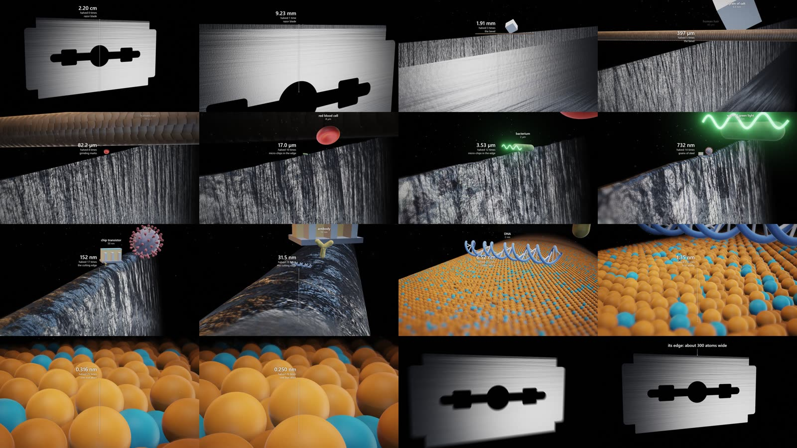

# zoom-explainer-3d

A Claude Code skill for making coded 3D "infinite zoom" explainer videos: one continuous camera move across many orders of magnitude, a live measurement on screen, and familiar objects beside the subject for scale. Every frame is drawn by code (Three.js, headless Chrome on the GPU, ffmpeg). No video-generation models, no stock footage.



The reference film, "Nothing is really sharp", flies from a razor blade (2.2 cm) to a single iron atom (0.25 nm) in 26 halvings, passing a grain of salt, a hair, a red blood cell, a bacterium, a wave of green light, a virus, a chip transistor, an antibody and DNA on the way. Its project is the template in `assets/template/`.

## Install

Copy this folder into your skills directory:

```bash
git clone <this-repo-url> ~/.claude/skills/zoom-explainer-3d
```

Then ask Claude Code for something like "make a 3D zoom explainer about how thin a soap bubble is", or paste the prompt from [MASTER_PROMPT.md](MASTER_PROMPT.md).

## Requirements

- Node.js 20 or newer
- ffmpeg on the PATH
- Chrome: `npx puppeteer browsers install chrome`, a system Chrome, or `CHROME_PATH`
- A GPU. It runs on software rendering, but a frame then takes seconds instead of milliseconds.

## Try the template by itself

```bash
cd assets/template
npm install
node render.mjs --stills 1,10,20,30,40     # five JPEGs in out/
node render.mjs --full                     # out/video.mp4, a few minutes on a discrete GPU
```

## What is in here

| Path | What it is |
|---|---|
| `SKILL.md` | The workflow Claude follows: research, plan, adapt the template, review stills, render, verify |
| `MASTER_PROMPT.md` | A fill-in prompt for starting a new video, with topic ideas |
| `references/techniques.md` | How the template works and why |
| `references/pitfalls.md` | Failures already met, and their fixes |
| `assets/template/` | The working project: `main.js` (scene), `render.mjs` (renderer), `index.html` |

## Data in the reference film

Razor edge geometry (17 degree wedge, 40 nm tip radius) is from Roscioli, Taheri-Mousavi and Tasan, "How hair deforms steel", Science 369 (2020). Atom spacing is bcc iron (lattice constant 0.2866 nm). Atom colours are a convention: orange for iron, blue for chromium at about 13 percent. Blade coatings are left out.
